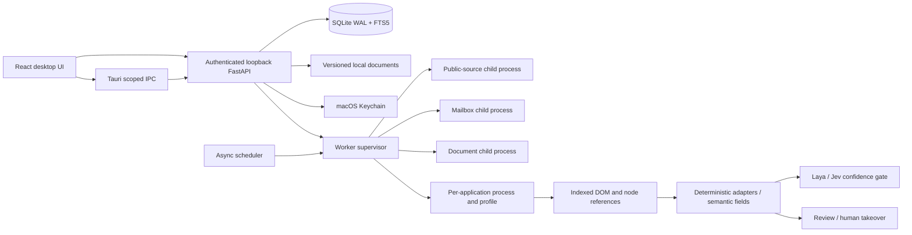

# Meridian — local job search workspace

Architecture decision, 29 September 2026. The product name is configured in desktop metadata and backend settings. Requirements: [original specification](docs/PRODUCT_REQUIREMENTS.es.md).

## Deployment and boundaries

Meridian is a Tauri 2 macOS application with a React/TypeScript/Vite UI and a Python 3.12 FastAPI sidecar packaged with PyInstaller. No hosted service is required. Tauri launches the sidecar on loopback with a random per-launch bearer credential, conveys its connection details through a scoped Rust command, and terminates its child on exit. Browser access in development uses an explicit token. The server validates both authentication and browser origins. Documents and external HTML are treated as untrusted input. There is no telemetry.

## Storage

Production root: `~/Library/Application Support/Meridian/`. Children: `database`, `documents`, `browser-profile`, `cache`, `logs`, `backups`, `models`. Development/tests may set `MERIDIAN_DATA_DIR`. SQLite connections enforce foreign keys, WAL, busy timeout. Alembic versions the schema. Database transactions protect unique canonical job identities and one application per job. Jobs retain source aliases and immutable snapshots; application events are append-only. Document versions use content hashes and immutable files. All secrets are stored in macOS Keychain, never database rows. Backups use authenticated encryption and exclude browser profiles/secrets.

Entity groups: candidate/facts/education/experience/projects/skills/relationships/preferences/answers; companies/domains/watch rules; jobs/source aliases/skills/snapshots/matches/duplicates; applications/events/answers/documents/emails; messages/classifications; automation runs/steps/human tasks; search profiles/sources/scheduler tasks; settings/integrations/secret references. Structured JSON is used for extensible source payloads and rule expressions, not as a substitute for indexed relationships.

## Discovery and matching

Source → fetch → normalize → canonical URL/ATS identity dedupe → snapshot → explainable weighted score → search profile filters → shortlist. Public ATS APIs are preferred. HTML ingestion uses JSON-LD JobPosting and semantic HTML. Restricted platforms open in the dedicated browser for user interaction; they do not get stealth automation. Polling is bounded and sources expose health/errors. Unknown salary, seniority or work authorization remains unknown. Matching combines normalized terms and an explicit semantic vocabulary; optional local model providers remain replaceable. Missing skills lower fit but do not silently reject unless an explicit user filter requires it.

## Browser execution

Snapshot controls atomically into indexed tables; retain actual element handles and document/page identities. Only enumerated operations on observed targets are permitted. Revalidate node attachment, visibility, enabled state, obstruction and document freshness immediately before acting. A new snapshot invalidates old decisions. Frames are individually observed; file upload resolves only registered immutable document versions. Laya and Jev select operation/target, never selectors, JavaScript or text answers. Text generation is a separate, evidence-constrained service.

Hierarchy: deterministic ATS semantics → generic accessible labels → configured Laya/Jev → human. Optional vision is outside the default execution path. Each ATS declares its capabilities honestly; complex or restricted forms escalate instead of claiming success. CAPTCHA/MFA blocks require manual completion. A submission requires independent visible confirmation or a linked confirmation email. An interrupted or uncertain submission is never blindly retried.

Manual prepares only. Review fills and pauses before any submit. Auto additionally requires verified answers, no sensitive questions, approved domain, score/confidence/rate limits and no duplicate. Global pause is checked before every browser action. Review approval is bound to the current snapshot and current answers/documents. Human takeover invalidates stale observations. No real job submission is used for tests.

## Email and status

Read-only Gmail OAuth, Microsoft Graph OAuth and IMAP over TLS use Keychain credentials. Providers fetch incrementally and deduplicate by provider/message ID. Classification extracts evidence, links conservatively using application ID/company/role/thread, and creates a human task for ambiguity. Confident classification creates an event and updates status with progression guards; late confirmations cannot regress an interview. Deadlines preserve source text/timezone. No email sending is implemented implicitly.

## Failure and privacy model

Network errors are surfaced per source/integration and retries use bounded backoff. Child-process failure is isolated from the API and UI. A run checkpoint records progress, never cookies or authentication headers; persisted URLs lose credential parameters and fragments. On restart, recoverable preparation resumes from semantic checkpoints with old approvals invalidated. Pending or uncertain submission requires reconciliation. Facts imported from CVs start unverified; only explicit verification/locking permits automatic use. Sensitive questions require an explicit policy. Text model outputs must cite existing verified fact IDs and remain drafts until reviewed where factual support is uncertain. Local inference is preferred; configured remote providers clearly disclose their data boundary.

## Verification and packaging

Unit tests cover normalization, matching, dedupe, answers, email classification and gates. Integration tests cover SQLite persistence/migrations, documents, email linking and HTTP authorization. Automated browser tests use local ATS fixtures, including uploads, multiple steps, stale nodes and confirmation. Separately authorised real-form dry runs stop before submission. Frontend typecheck/lint/build and Rust checks precede a locally signed `.app`/`.dmg`. End-to-end live account verification requires the user's own login/OAuth authorization; a local test is never represented as a real recruitment submission.

## October 2026 worker upgrade

The API owns a `WorkerSupervisor`, rather than a shared active browser. SQLite stores task state, account scope, lease, retry budget, checkpoints, heartbeat history, upload evidence and submission receipts. Each application runs in its own OS process and local profile at `browser-profile/applications/<application-id>`. Discovery, mailbox sync, document generation and manual browser sessions use separate child processes. Production PyInstaller dispatches `--meridian-worker`; tests may explicitly select the legacy in-process fixture path.

The supervisor claims tasks transactionally and serialises work within an ATS tenant/account scope. Application concurrency defaults to two and is configurable from one to six. Heartbeats arrive every second; the default missing-heartbeat limit is 30 seconds, preparation-progress limit is 240 seconds, and retry budget is three attempts with bounded exponential backoff. A legitimately parked review is exempt from the progress watchdog. After 15 minutes the browser may be released; Resume restores the same durable task. Memory monitoring includes the owned process group and Chrome helpers, supplemented by the worker's reported peak RSS. Shutdown terminates only owned groups and leaves recoverable task records.

A restart invalidates DOM approvals and recovers preparation from semantic checkpoints: URL, current form state, completed steps, verified answers, selected document IDs/hashes and upload evidence. Browser element indexes are never restored. Submission receipts are written transactionally before clicking. A pending or uncertain receipt blocks replay; confirmation pages, linked email or explicit reconciliation resolve it. A queued preparation is skipped if email/manual tracking already advanced the application.

Public-source scans run with four-way bounded concurrency and a 120-second per-source limit. Daily discovery is queued at 08:00 in the configured timezone with catch-up on the next available scheduler tick; mailbox sync queues independently. Complete Greenhouse/Lever/Ashby boards can establish OPEN/CLOSED by presence/removal. Generic pages and truncated Workday boards cannot establish closure by absence. Workday queries use observed tenant/site URLs and cap results; listing-only descriptions and deadlines remain unknown. Source coverage distinguishes configuration from successful scanning.

Networking adds evidence-backed contacts, job links, grounded drafts, outreach history and follow-ups. The approved manual handoff copies the reviewed text and opens the exact profile. Sending is recorded only after explicit confirmation. Imported received text enters the same conservative recruitment classification pipeline as email.
